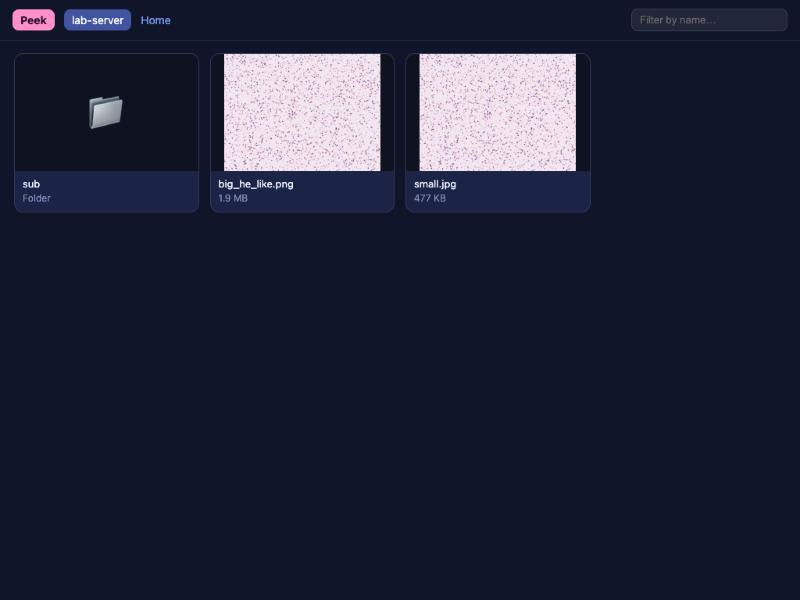
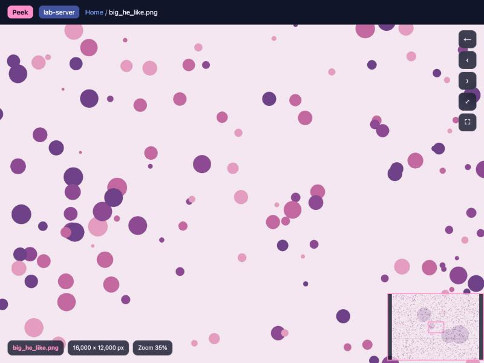

# peek

**Zoom into huge images on a server, in your own browser — like QuPath, without copying the file.**

Whole-slide images (`.svs`, `.ndpi`, `.mrxs`, OME-TIFF …) and other huge PNG/JPEG/TIFF files usually live on a lab server. Downloading a 10 GB slide to look at one region is slow, and opening it in VS Code is worse. `peek` cuts the image into small tiles **on the server** and streams only what you are looking at to your browser, so even gigapixel slides scroll and zoom smoothly.

[中文说明](README.zh-CN.md)

| Browse a folder | Zoom in anywhere |
|---|---|
|  |  |

## Install

On your own computer (macOS, Linux or Windows WSL), no sudo needed:

```bash
curl -fsSL https://raw.githubusercontent.com/liuxiaZzz/peek/main/install.sh | bash
```

or

```bash
git clone https://github.com/liuxiaZzz/peek.git && peek/install.sh
```

Nothing needs to be installed on the server except Python with a few common packages (see [Requirements](#requirements)).

## Use

```bash
peek gpu-server:/data/slides            # browse a folder on a server
peek gpu-server:/data/slides/a.ome.tif  # open one image
peek ~/Pictures/big.png                 # a local folder or image
```

`gpu-server` is anything `ssh` understands: a host from your `~/.ssh/config`, or `user@host`. Your browser opens automatically.

| In the browser | |
|---|---|
| Scroll / drag | zoom / pan |
| ← / → | previous / next image in the folder |
| Esc | back to the folder |
| `0` / `f` | fit to window / full screen |
| ⌘-click (Ctrl-click) a thumbnail | open it in a new tab, e.g. to compare slides side by side |
| Browser back / forward | work as expected; refreshing keeps your place |

Slides with physical size information show µm per pixel and a scale bar. A minimap shows where you are.

Press **Ctrl-C** in the terminal to stop. Closing the terminal stops it too, and the viewer on the server also exits by itself after 3 hours without use.

You can run several `peek`s at once (different folders or servers); each gets its own port.

## Requirements

**Your computer:** `bash`, `ssh`, a browser. That's it.

**The server** (or your computer, for local files) needs Python 3 with:

| Files | Packages |
|---|---|
| PNG, JPEG, plain TIFF | `pillow` |
| OME-TIFF, pyramidal TIFF | `pillow` `tifffile` `zarr` `imagecodecs` |
| `.svs` `.ndpi` `.mrxs` `.scn` … | `pillow` `openslide-python` `openslide-bin` |

`peek` looks through your conda environments and uses the one that has the most of these, so if you already have a pathology environment (CLAM, TRIDENT, CellViT, …) nothing needs installing. If something is missing it offers to install it, or you can run:

```bash
peek --setup gpu-server        # pip install --user the packages above on that server
```

To force a specific interpreter: `peek --python ~/miniconda3/envs/myenv/bin/python gpu-server:/data`.

## How it works

1. `peek` sends a small Python program ([`peek_server.py`](peek_server.py)) over your ssh connection and runs it on the server. It is not installed there.
2. The program serves image tiles and the viewer page on **127.0.0.1 only** (not reachable from the network). `peek` forwards that port to your computer through the same ssh connection.
3. Your browser shows the tiles with [OpenSeadragon](https://openseadragon.github.io/). For pyramidal files (OME-TIFF, `.svs` …) each tile is read from the closest pyramid level, so zooming out never decodes the full-resolution image.

Tiles are re-encoded as JPEG (quality 82) for the browser: at 100% zoom they are within about 39 dB PSNR of the stored pixels, visually indistinguishable for most purposes.

## On a server already?

If you run `peek some/file` inside an ssh session, it prints the command to run on your own computer instead, since the browser is there.

## Uninstall

```bash
curl -fsSL https://raw.githubusercontent.com/liuxiaZzz/peek/main/uninstall.sh | bash
```

or from a clone: `peek/uninstall.sh`. Python packages are left alone.

## License

Apache-2.0
